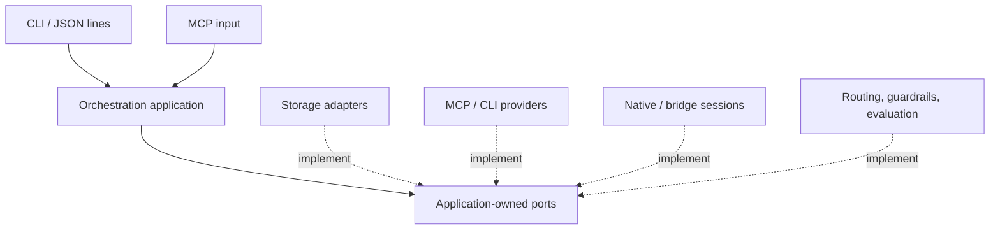

# Xorchestrate application architecture

The application coordinates work, actors, messages, sessions, tool invocations,
assessments, and retained evidence. It depends on purpose-oriented ports. Adapters
implement those ports, and the composition layer selects implementations from
trusted local configuration.

The purpose of this boundary is practical: changing a transport, database, agent
harness, or policy should not require changing the orchestration use cases. A
role name, a stack preference, or an agent's earlier recommendation must not
become an application invariant merely because it appeared in the first project.

Dependencies point toward the application contracts; composition selects the
adapters that fulfill them:



## Responsibilities

| Boundary | Owns | Does not decide |
| --- | --- | --- |
| Application | Work and coordination records, action sequencing, effect tracking, retained results | Database, transport, executable, vendor, project stack |
| State store | Transactions, record versions, event sequence, persistence | Agent hierarchy or work acceptance |
| Capability provider | Discovery and invocation of external tools | Authority inferred from tool output |
| Session driver | Starting and communicating with an agent session | Who must plan, delegate, or approve work |
| Routing policy | Recipients for a destination in the current actor/relationship context | A compulsory organization chart |
| Guardrail | Whether a requested action is allowed under explicit policy | Model reasoning or arbitrary host isolation |
| Evaluator | An assessment with rationale, confidence, and evidence | Permission to override policy |
| Acceptance policy | Decisions over current owner requirements and bound measurements | Replacing missing or failed required evidence with confidence |
| Session selection / delivery scheduling / retry / receipt | Replaceable routing-to-native-delivery responsibilities | Conflating submission, receipt, response, completion and acceptance |
| Composition and input adapters | Trusted configuration, adapter lifetime, CLI/MCP encoding and identity | Domain-specific project practices |

The core is usable with supplied ports without importing SQLite, subprocesses,
MCP machinery, or the historical runtime. Memory and SQLite stores exercise the
same contract. External capabilities can be added through discovery, without
editing a central list of project-specific commands.

CLI and MCP are input adapters for the same application operations. MCP providers
and CLI providers are also output adapters for project context and tools. A port
expresses an application need; it is not a wrapper for a particular wire protocol.

The CLI `call` command performs one operation and closes its owned adapters.
`run` keeps a runtime open and processes JSON lines shaped as `{"action": "...",
"arguments": {}}`, returning a `result` or `error` envelope per line. MCP `serve`
also keeps the runtime open. Use a persistent input connection for session work;
one-shot commands are appropriate for durable work records and discrete tool
operations.

## Composition and configuration

Use `--config PATH` to select a JSON configuration explicitly. Built-in SQLite
paths and provider/session working directories resolve against that file's
directory. Custom adapter options follow that adapter's contract. Without a file, the local defaults use
SQLite at `.xorchestrate/state.sqlite3`, configurable routing, and an allow policy;
no provider, session driver, or evaluator is required for basic work tracking.

The top-level sections are:

| Section | Selection |
| --- | --- |
| `store` | One state-store adapter and its `options` |
| `providers` | Named capability providers, each with `adapter` and `options` |
| `sessions` | Named session drivers, each with `adapter` and `options` |
| `guardrail` | An enforcement adapter and its options |
| `routing` | A routing adapter and its options |
| `evaluators` | Named assessment adapters and their options |
| `assessment` | Which evaluator supplies triage, when to escalate, and the heavier evaluator |
| `acceptance` | Current required-check acceptance policy |
| `session_selection` | Eligible native session for each recipient |
| `delivery_scheduler` | Manual/default or immediate/configured delivery scheduling |
| `retry_policy` | Retry permission after a definite failed attempt |
| `receipt_policy` | Verification of complete exchange evidence |
| `session_fallbacks` | Explicit unavailable-name to configured-driver substitutions |

An adapter selection may use a supplied alias or a trusted installed
`module:factory` implementation. Factories receive options, with dependency-aware
built-in adapters assembled by composition. Disabled named entries (`enabled:
false`) are not activated. Configuration is read for the assembled application;
unrelated historical source edits do not invalidate ongoing work or retained
results. Restart with the intended configuration to activate a change.

Configuration is trusted execution input. It selects commands and installed code;
it is not accepted from provider output. Tool arguments carry operation data,
not replacement executable paths or shell fragments. Provider invocation uses
configured argument arrays and JSON data, not shell interpolation.

The default actor is `owner`. A local CLI invocation or stdio MCP server binds its
chosen actor when started. This is a local trust boundary, not remote login or
multi-tenant authentication. A future network adapter must establish its caller's
identity before calling the same application boundary.

## Work, organization, and judgment

Work can be created and updated without a planner, a manager chain, or a model
account. Actors can have free-form roles and relationships. Routing and declared
guardrails can use those records; none of the historical CO/XO/NCO roles is built
into the application.

Project goals, source observations, UX context, explicit opinions, and checks come
from the caller and configured MCP/CLI capabilities. The application stores the
provided context and evidence. It does not impose Symfony paths or treat observed
source structure as a declared standard. An assessment result remains an
assessment; it does not rewrite guardrails or configuration.

External capability calls receive the caller, work, and operation identifiers and
the selected capability descriptor as context. The descriptor binds each call to
its authorized discovery snapshot, including during concurrent discovery.
Project data is supplied through explicit tool arguments, rather than
implicitly copying the work's entire evidence history to every provider. Policies
can inspect the richer internal context; assessment requests deliberately include
the context being evaluated.

Assessment is optional. A selected triage evaluator can be Jev or another adapter.
The assessment configuration names the heavier evaluator and the conditions for
escalation, including a confidence threshold and uncertain outcomes. Missing
confidence or unresolved output must remain visible. An unresolved assessment is
not silently converted into permission, and the default work-tracking path does
not require evaluator credentials.

Policy enforcement and inference are separate responsibilities. A policy may
allow an action, deny it, or require review. Evaluation may inform the caller's
next decision, but a provider cannot turn its own recommendation into authority.
Choose guardrails for the deployment's real boundaries and connect any desired
approval flow explicitly.

For example, the rules adapter can require review for a deployment provider while
leaving unrelated actions available:

```json
{
  "guardrail": {
    "adapter": "rules",
    "options": {
      "default": "allow",
      "rules": [{
        "id": "review-release",
        "effect": "review",
        "actions": ["invoke"],
        "capabilities": ["deploy/*"],
        "reason": "Owner reviews releases"
      }]
    }
  }
}
```

Rules can match configured actors, roles, providers, capabilities, and exact
context values. Numeric values compare by value (`1` matches `1.0`); booleans
remain distinct from numbers, including inside objects and arrays.
A matching denial wins over review, and review wins over allow.
Review is a blocked action with an explicit reason; this adapter does not invent
an approval authority or persist a blanket bypass.

Discovery is authorized as `capabilities` for the selected provider. Invocation
is then authorized as `invoke` against the discovered descriptor. With a
default-deny policy, allow the required discovery and invocation separately.
Descriptors stay bound to that invocation; a reported catalog change requires
fresh discovery and authorization. Tool annotations remain supplied metadata,
not proof that an executable will honor them.

The configurable routing adapter accepts direct actors, role selections, and
named relationships, for example `{"actors":["reviewer"]}` or
`{"relationship":{"name":"consults","direction":"outgoing"}}`. Multiple
selections form a union. Broadcast and inclusion of the sender are options,
not consequences of a built-in management role.

## External effects and evidence

External effects use explicit idempotency keys. The stored operation binds the
key to its request. A repeated completed request can return the retained result;
a different request cannot reuse the same identity. The application records
intent before external I/O, performs I/O outside the database transaction, and
then retains the outcome and associated events.

This is not a claim of exactly-once execution across arbitrary tools. A process
may disappear after an external effect but before its result is retained. Such
an outcome stays unknown until reconciled; replaying the same request does not
blindly execute it again. Inspect the operation and external evidence before
resolving it. A failed or unknown operation is distinct from successful work.

`invoke` accepts `capability`, `arguments`, and `idempotency_key`, with optional
`work_id`. Session start, send, poll, and stop also require effect keys. Keys are
bound to the caller as well as the operation and payload. Use `get_operation` to
inspect a retained effect. `resolve_operation` requires its current version, a
verified outcome, and a reason; it records that reconciliation without repeating
the external operation. A result retained before a local application failure can
be reconciled from the retained data.

Successful session-start reconciliation uses only the adapter result already
retained as `external_result`. A caller cannot supply or replace its backend
identifiers. An unknown start without that receipt cannot be reconciled into an
imported native connection. After investigating the external outcome, the caller
can record the attempt as failed and make a separate authorized start request;
this does not automatically retry the original operation.

Records use compare-and-replace versions, and each storage transaction commits
its records and events together. Evidence and returned data remain inspectable;
the application does not infer successful delivery from a transport merely
starting or a model claiming completion.

Session drivers retain backend identifiers in application records. Durable
application state does not itself make a vendor process durable. Process lifetime,
resume support, and reconnect behavior belong to the driver and must be reported
accurately. An unavailable session handle is not a license to target a reused PID
or silently create a replacement conversation.

To resume, `start_session` accepts a top-level `resume_session_id` identifying a
stored application session. The requested driver must match that session's
driver. The application authorizes `send_session` against the source session's
actor, work, and evidence context, and `start_session` against the requested
destination; it verifies both authorization snapshots before the effect.
Configured policy can permit delegation across actors or work items. A source
with an unresolved pending or unknown effect must be reconciled before ordinary
resumption. Explicit `reconnect_session` can restore observation/control while
retaining the source uncertainty fence; it cannot silently authorize another
send. Runtime shutdown marks owned connection records disconnected. A crash can
leave a stale durable state, so adapters also validate their live handles.

Resumption creates a new connection record with source lineage as provenance.
That lineage does not automatically propagate later policy revocation to the new
record; subsequent actions evaluate current policy in the new session's context.
Drivers opt into the `ResumableSessionDriver.resume(backend,
specification)` port and map the stored opaque backend to their native protocol.
Caller-supplied `specification.resume` native identifiers are rejected.
Resumable records link through `start_operation_id` to an adapter-issued receipt.
Pre-fix stored sessions lacking that provenance require a fresh start; caller
reconciliation results cannot import their native identities.

The supplied Codex adapter accepts complete command arguments, such as
`["codex","app-server","--listen","stdio://"]`. Its configured `thread` and
`turn` options carry native settings. Authorized resumption opens the stored
native thread in a new process. Sending acknowledges submission; continuously dispatched native callbacks and
notifications establish progress and completion separately. Polling reads retained
observations. Native tools are governed by the chosen native policies, while
application-provided dynamic tools cross the application's guardrails.

Drivers that expose application tools opt into
`ApplicationToolSessionDriver.bind_application_tools(capabilities, handler)`.
The handler receives an action, JSON arguments, trusted session context, and an
optional adapter invocation key. Composition binds the caller and work context,
and scopes effect keys to the configured driver. Each adapter translates its
own protocol, tool descriptors, and request identities; the shared wiring does
not require Codex request fields. Configured native tools and raw native request
handlers remain adapter features. Conflicting application/native tool names
must be resolved in configuration before sessions start.

Native execution policy belongs in trusted adapter options: Codex `thread` and
`turn`, or ACP `session` settings, including any MCP server commands. By default,
Codex and ACP accept only empty caller-supplied `specification.parameters`.
An operator can delegate bounded choices through an `options.request_parameters`
JSON Schema; the driver validates those choices before spawning a process.
Configured native settings override delegated values. Native session identities
and Codex dynamic tools remain driver-owned even when a schema permits extra
properties. See the [bounded delegation example](../examples/README.md#bounded-native-parameter-delegation).

The generic JSON-RPC driver uses configurable session start/send/poll/stop methods
for an installed bridge. ACP, Grok Build and Claude Code are also supplied
protocol adapters. The external-session host exposes ownership-aware attachment
without terminating its native conversation when a client disconnects. The transport
uses bounded frames, timeouts, explicit environment forwarding, and process
cleanup. These mechanisms do not make an arbitrary executable safe; choose the
process environment and capabilities for the intended work.

## Reuse and extension

`devtools/` and `legacy/agentscient/` are implementation source collections.
Useful protocol handling, integrity mechanisms, and fixtures can be adapted behind
the new ports. The active package does not import the legacy runtime and thereby
inherit its hierarchy, mandatory evaluator setup, source-hash coupling, or
historical delivery policy. The active application now owns durable delivery
attempts and composes explicit session selection, scheduling, retry and receipt
policies; message routing retains the exact actor/relationship snapshot used at
enqueue. Ordinary caller acknowledgements remain separate from native receipts.

Historical instructions were moved from `.agents/skills` to
`reference/imported-agent-skills`; their active `.claude/skills` aliases were removed.
Imported operator documents are marked as
historical. Source regression tests remain separate from the new application
suite. Their passing behavior is evidence about that source, not a preservation
requirement for the new architecture.

There is no automatic migration of imported state and no assertion that every
historical capability has been ported. The current adapter tests use real local
process boundaries and fixtures. Live vendor/model availability, a real Jev
endpoint, and project-specific acceptance require the actual tools, credentials,
and workspace. See [validation](../.github/CI.md) for the checks and limits.

When extending the system, implement or replace the boundary that owns the
variation, verify the relevant contract, and keep policy choices inspectable.
A new abstraction earns its place by separating a real responsibility; the port
list is allowed to evolve with the system.

## Behavioral preservation and verification

See [native sessions](native-sessions.md), [external session lifecycle](external-session-bridge.md),
[work acceptance](work-acceptance.md), and the [implementation handoff](implementation/HANDOFF.md).
Owner outcomes and candidate revisions remain separate from subordinate work.
Native call replay is durably fenced, including actions without application effect
keys. Observation and control remain available during uncertain effects. Only
pre-effect optimistic authorization conflicts are eligible for bounded callback
retry; every retry reevaluates current authorization. A committed message enqueue
is never repeated because immediate dispatch later conflicts.

The deterministic full suite and local native procedure use the active
composition and retain requested coverage separately from measured coverage.
Protocol fixtures do not establish authenticated vendor behavior. Native
acceptance and independent review have their own explicit states.
